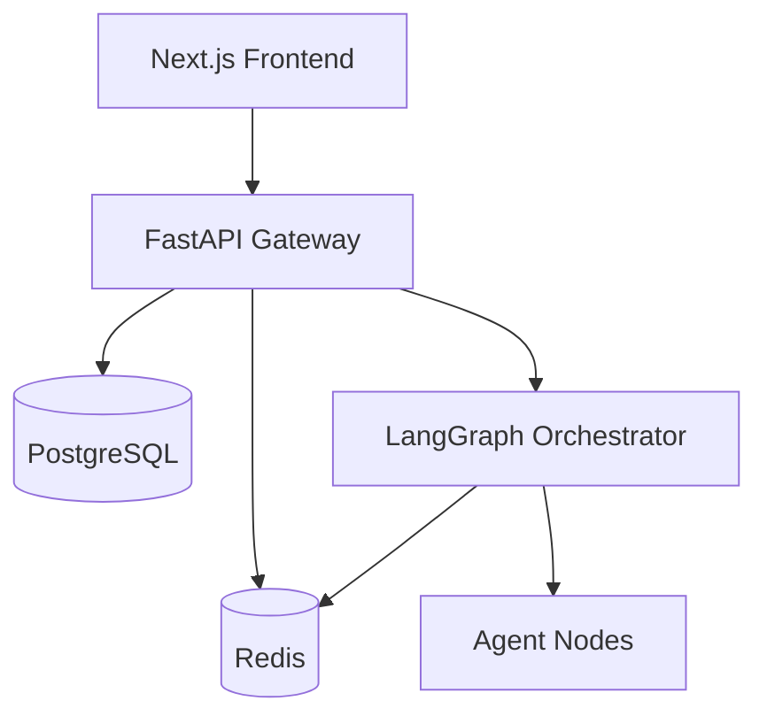

# Phase 1 — Foundation Infrastructure

**Status: Complete (v0.1)**

## Goals

Establish the repository, containerized stack, API gateway, persistence layer, LangGraph orchestrator skeleton, and enterprise dashboard shell.

## Deliverables

### Repository & DevOps

- [x] Monorepo structure (`backend`, `orchestrator`, `frontend`, `infrastructure`)
- [x] `.env.example` — no committed secrets
- [x] `docker-compose.yml` with health checks and service dependencies
- [x] `.gitignore`

### Data layer

- [x] PostgreSQL 16 with init extensions
- [x] Redis 7 for transient state
- [x] SQLAlchemy models: `User`, `Project`, `Workflow`, `AuditLog`
- [x] Seed admin user

### API Gateway (FastAPI)

- [x] JWT authentication (`POST /api/v1/auth/login`)
- [x] Project CRUD
- [x] Workflow lifecycle endpoints (start, state, logs, approve, revise)
- [x] Orchestrator HTTP client (service-to-service)
- [x] Audit logging
- [x] Prometheus `/metrics` mount
- [x] Input validation + basic prompt-injection guardrails

### Orchestrator (LangGraph)

- [x] Deterministic `StateGraph` with all pipeline stages
- [x] Planner agent (structured execution plan)
- [x] Stub agents for remaining stages (wired, not yet LLM-powered)
- [x] Revision loop with configurable thresholds
- [x] Internal API with API key auth
- [x] Human approval gate

### Frontend (Next.js)

- [x] Enterprise dark dashboard theme
- [x] Login flow
- [x] Project dashboard
- [x] Workflow visualization (pipeline component)
- [x] Placeholder sections: prompts, review, observability, agents

## Architecture diagram



## Run & verify

```bash
cp .env.example .env
docker compose up --build
```

1. Login at http://localhost:3000
2. Create a project
3. Start workflow from Workflows page
4. Observe pipeline stages updating

## Known limitations (addressed in later phases)

- Agents are stubs (no LLM calls)
- In-memory orchestrator checkpointing (not Redis-backed yet)
- RBAC is basic (role enum, not full policy engine)
- No RabbitMQ, Chroma, or Ollama in default compose profile

## Next phase

→ [Phase 2: Core Workflow](phase-2-core-workflow.md)
